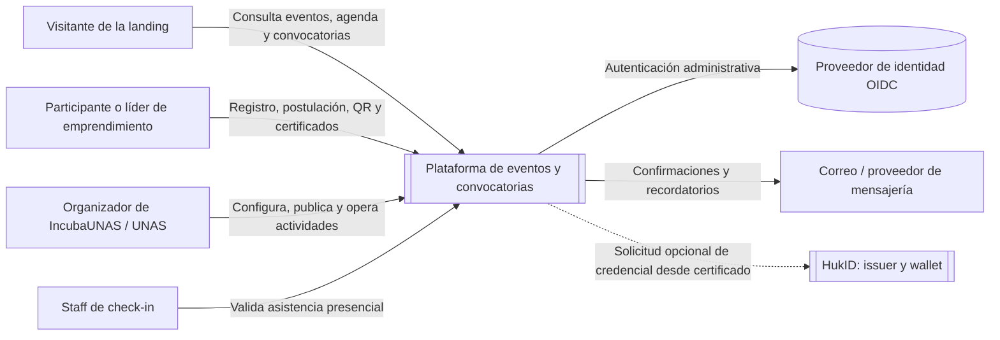
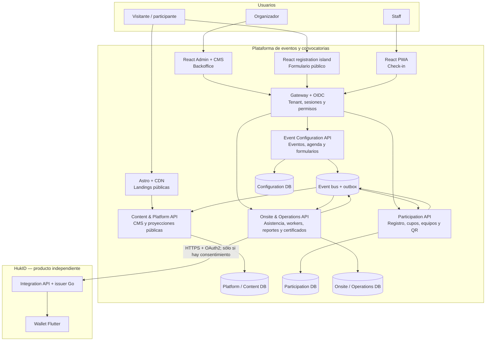

# Plataforma de eventos, congresos y convocatorias

> Una plataforma para que IncubaUNAS, la UNAS y futuras instituciones creen, publiquen y operen eventos, congresos y convocatorias sin depender de formularios dispersos, listas impresas ni procesos manuales de check-in.

## El problema que resolvemos

Hoy, una actividad de IncubaUNAS suele comenzar con una publicación en redes sociales y un Google Form. Después, el equipo exporta respuestas, consolida listas y marca asistencia manualmente el día del evento. Este flujo funciona para actividades pequeñas, pero pierde trazabilidad y se vuelve riesgoso cuando aumentan los registros, hay cupos limitados, programas paralelos, postulaciones de emprendimientos o premios.

La complejidad aumenta porque no todos los eventos son iguales:

- Un taller o Demo Day puede requerir sólo agenda, registro individual y asistencia.
- Un congreso puede tener programas, tracks o escuelas que se realizan al mismo tiempo.
- Una convocatoria puede inscribir emprendimientos, no sólo personas; cada equipo tiene integrantes, archivos, requisitos y una postulación evaluable.
- Algunas actividades son gratuitas y otras pueden incorporar pagos en una etapa posterior.
- La institución necesita publicar cada actividad en su propia landing, administrar los datos con permisos y emitir evidencia de participación.

La plataforma reemplaza ese flujo fragmentado por un proceso digital único, trazable y escalable.

## Visión de producto

Crear una solución multiinstitución que permita operar el ciclo completo de un evento o convocatoria:

1. La institución crea y publica su landing y el evento desde un CMS.
2. Las personas se registran o los líderes postulan a su emprendimiento/equipo.
3. El sistema gestiona cupos, lista de espera, confirmaciones y tickets QR.
4. El personal registra asistencia con una PWA de check-in rápida.
5. La organización consulta resultados, envía comunicaciones, genera reportes y emite certificados.
6. Opcionalmente, un certificado puede convertirse en una credencial verificable mediante HukID, sin acoplar la operación del evento a la wallet.

El primer cliente natural es **IncubaUNAS**, pero el producto está diseñado para servir también a facultades, oficinas y unidades de la **UNAS**, y luego a otras instituciones que organizan congresos, ferias, concursos, programas o convocatorias.

## Objetivos de negocio

| Objetivo | Resultado esperado |
|---|---|
| Vender un MVP útil rápidamente | Una institución puede publicar un evento, recibir inscripciones, hacer check-in y emitir un certificado sin Google Forms ni listas impresas. |
| Reducir trabajo operativo | Menos consolidación manual de hojas de cálculo, menos duplicados y mejor visibilidad de cupos/asistencia. |
| Mejorar la experiencia del participante | Landing clara, registro confiable, confirmación, ticket QR y autoservicio básico. |
| Soportar convocatorias reales | Emprendimientos, equipos, adjuntos, revisiones y decisiones de admisibilidad. |
| Crecer sin rediseñar | Sitios públicos preparados para campañas de redes y APIs transaccionales aisladas para registro y check-in. |
| Mantener una evolución abierta | Pagos, integraciones institucionales y HukID pueden añadirse sin rehacer el núcleo. |

## Capacidades del producto

### Para visitantes y participantes

- Consultar landings institucionales, catálogo de eventos y agendas con tracks paralelos.
- Registrarse de forma individual, verificar correo cuando aplique y consultar/cancelar el registro.
- Recibir un ticket QR sin datos personales expuestos.
- Postular un emprendimiento, invitar integrantes, completar requisitos y adjuntar archivos.
- Consultar estado de una postulación y descargar/verificar certificados emitidos.

### Para organizadores

- Crear eventos, congresos, talleres, concursos y convocatorias.
- Configurar programas, sesiones, sedes, ponentes, cupos y reglas de inscripción.
- Diseñar formularios versionados y consentimientos sin modificar código.
- Publicar cambios de forma consistente hacia la landing, el registro y el check-in.
- Revisar registros/postulaciones autorizadas, enviar comunicaciones y consultar reportes.
- Configurar reglas de elegibilidad y emitir, revocar o reemplazar certificados.

### Para personal operativo

- Iniciar un turno de check-in para el evento, sede o sesión asignados.
- Escanear QR, buscar manualmente cuando sea necesario y registrar salida o correcciones trazables.
- Operar sin editar directamente registros, cupos o tickets.

## Alcance del MVP comercial

El MVP demuestra un flujo completo y vendible:

```text
Landing institucional → evento publicado → inscripción/postulación →
confirmación y QR → check-in → reporte básico → certificado PDF
```

Incluye CMS/landing, agenda, formularios, registro individual, cupos/lista de espera, equipos de emprendimiento, ticket QR, check-in online, comunicaciones transaccionales, reportes básicos y certificados PDF.

Quedan para incrementos posteriores: pagos y facturación, evaluación avanzada, mentorías, check-in offline, integraciones institucionales complejas y capacidades avanzadas de OID4VP. HukID puede integrarse como plus cuando el piloto demande credenciales verificables.

## Arquitectura en una vista

La plataforma no separa servicios por moda ni por pantalla. Aísla las tres cargas que más cambian bajo presión: lectura pública, inscripción concurrente y check-in presencial.

| Carga | Riesgo | Decisión |
|---|---|---|
| Landings y catálogo | Miles de visitas después de una publicación en Facebook | Astro, CDN y proyección pública cacheable |
| Inscripción y postulación | Picos de escritura, duplicados y sobrecupo | Participation con idempotencia, rate limits y cupo atómico |
| Check-in | Filas, QR duplicados y conectividad variable | PWA y servicio Onsite con validación local/proyectada y hechos append-only |

## C4 — Diagrama de contexto

Este nivel muestra quién usa el sistema y qué sistemas externos se relacionan con él.



**Límite importante:** HukID es un producto independiente. La plataforma de eventos puede solicitar una credencial para un certificado elegible, pero no depende de la wallet para registrar asistentes ni para operar un evento.

## C4 — Diagrama de contenedores

Este nivel explica los componentes desplegables principales y cómo se distribuye el trabajo de los cinco equipos.



### Límites que protegen la operación

- Las visitas públicas no consultan directamente bases de registro ni de configuración.
- Sólo Participation confirma cupos, administra lista de espera y emite/revoca tickets.
- Sólo Onsite registra hechos de asistencia; no modifica registros ni cupos.
- Cada servicio posee su propia base lógica, migraciones y contratos. No existen joins, foreign keys ni transacciones distribuidas entre servicios.
- Los cambios se propagan con eventos versionados y proyecciones locales; el registro y check-in siguen siendo seguros bajo carga.

## Organización del desarrollo

| Equipo | Producto end-to-end | Responsabilidad principal |
|---|---|---|
| 1. Content & Platform Foundation | Astro, CMS React, Admin shell, gateway y OIDC | experiencia pública, identidad, tenancy y plataforma compartida |
| 2. Event Configuration | Backoffice de eventos y API de configuración | eventos, agendas simultáneas, formularios y releases publicados |
| 3. Participation | Formulario público, backoffice y API de inscripción | cupos, waitlist, QR, emprendimientos, equipos y postulaciones |
| 4. Onsite Operations | PWA de check-in, workers y operaciones | asistencia, comunicaciones, reportes, certificados y adaptador HukID |
| 5. HukID | Issuer/API Go y wallet Flutter | credenciales verificables independientes de Events |

El detalle de historias, criterios de aceptación y corte MVP está en el [índice canónico de backlogs](BACKLOG-INDEX.md).

## Principios de confianza y escalabilidad

- **Privacidad por diseño:** respuestas y datos personales permanecen en Participation; los demás módulos reciben sólo el mínimo necesario.
- **Trazabilidad:** publicaciones, cambios de estado, check-ins, correcciones, certificados y exportaciones quedan auditados.
- **Consistencia publicable:** una release de evento contiene agenda, formularios y reglas compatibles; los consumidores activan una versión completa o ninguna.
- **Seguridad operativa:** autenticación OIDC, permisos por institución/evento/sede, MFA para acciones sensibles y sesiones revocables.
- **Concurrencia segura:** comandos idempotentes, ETag para edición, cupo atómico y eventos procesables más de una vez sin efectos duplicados.
- **Evolución independiente:** HukID, pagos y capacidades adicionales se integran por contratos, no por bases compartidas.

## Recorrido integral de actores

El diagrama interactivo muestra el proceso desde la publicación de la actividad hasta el certificado y, de manera opcional, la emisión de una credencial en HukID. Incluye vistas enfocadas en eventos/congresos, convocatorias de emprendimiento y la integración HukID.

- [Abrir diagrama de flujo interactivo](diagrams/event-platform-actor-journey.workflow.html)
- [Especificación fuente de Archify](diagrams/event-platform-actor-journey.workflow.json)

## Documentación del repositorio

### Producto, alcance y planificación

- [Índice de backlogs y corte MVP](BACKLOG-INDEX.md)
- [Plan de equipos y cargas](TEAM-DELIVERY-PLAN.md)
- [Auditoría de cobertura](COVERAGE-AUDIT.md)
- [Historias Equipo 1](backlogs/TEAM-1-CONTENT-PLATFORM.md)
- [Historias Equipo 2](backlogs/TEAM-2-EVENT-CONFIGURATION.md)
- [Historias Equipo 3](backlogs/TEAM-3-PARTICIPATION.md)
- [Historias Equipo 4](backlogs/TEAM-4-ONSITE-OPERATIONS.md)
- [Historias Equipo 5 — HukID](backlogs/TEAM-5-HUKID.md)

### Arquitectura y contratos

- [Architecture Spine](ARCHITECTURE-SPINE.md)
- [Arquitectura de microservicios](MICROSERVICES-ARCHITECTURE.md)
- [Contrato de autenticación y autorización](AUTH-AND-AUTHORIZATION-CONTRACT.md)
- [Contratos de integración](INTEGRATION-CONTRACTS.md)
- [Catálogo de APIs](contracts/API-CONTRACTS.md)
- [Contratos de eventos](contracts/EVENT-CONTRACTS.md)
- [Máquinas de estado](contracts/STATE-MACHINES.md)
- [Ownership, privacidad y retención](contracts/DATA-OWNERSHIP-AND-RETENTION.md)
- [Bases de datos y migraciones](contracts/DATABASE-BOUNDARIES-AND-MIGRATIONS.md)
- [Gate de corrección](reviews/CORRECTION-GATE.md)

`TEAM-BACKLOGS.md` se conserva como historial del reparto inicial y no es fuente de implementación.
